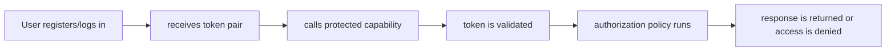

# Identity, Authentication and Authorization

- Status: As-built baseline
- Date: 2026-09-21
- Catalog capability ID: `identity-authentication-and-authorization`
- Last verified: `603d84a2f88297c9e7fd1b7143df3980fb21e24d` (2026-09-20 UTC)
- Owners: VaultStadio maintainers
- Scope: Record user identity, JWT lifecycle, roles, permissions, and protocol-specific authentication boundaries.
- Related issues/PRs: #71, #124
- Required review gates: product UX, architecture, testing, documentation, security/operations
- Open decisions blocking readiness: see the explicit decisions and limitations below

## 1. Executive summary

Authentication identifies a caller; authorization decides what that caller may do. The baseline separates those concerns across REST, WebDAV, S3, and admin surfaces.

This document is an integrated product and engineering contract. For an as-built baseline, it records current behavior and the contract maintainers choose to preserve; it does not by itself authorize a behavior change.

## 2. Problem, current behavior, and evidence

### 2.1 Problem

Security and configuration guides mix JWT, storage, WebDAV, and S3 claims without a single matrix of identity, authentication, authorization, expiry, and failure behavior.

### 2.2 Current behavior

Auth routes implement registration, login, refresh, logout, and protected route behavior. Security config wires bearer/JWT, WebDAV Basic Auth, and optional protocol providers.

### 2.3 Evidence

- `backend/api/src/main/kotlin/com/vaultstadio/api/config/Security.kt`
- `backend/api/src/main/kotlin/com/vaultstadio/api/routes/auth/AuthRoutes.kt`
- `backend/core/auth`
- `backend/application/auth`
- `backend/api/src/test/kotlin/com/vaultstadio/api/config/SecurityTest.kt`
- `docs/operations/SECURITY.md`

### 2.4 Retrospective classification

- **Observed behavior:** the current behavior described above is supported by the listed checkout evidence.
- **Intentional contract:** only the invariants and acceptance scenarios in this SDD are proposed for preservation; historical motivation is not inferred.
- **Known debt and limitations:** documentation/source mismatches, incomplete external verification, and explicitly named unsupported operations remain debt until closed.
- **Unknown rationale:** historic reasons for the current structure are unknown unless a source reference states them.
- **Proposed improvements:** any future change is listed in the implementation sequence and must not be read as implemented behavior.

### 2.5 Audit checkpoint — 2026-10-25

Los flujos de sesión opaca, rotación, logout y denegación de admin pasan en HTTP real. A01 confirma huecos de autorización entre capacidades. El primer registro en DB vacía tiene rol USER; reconciliar la documentación de JWT y bootstrap administrativo.

Evidencia parcial de producto en master `615f11adf5272bd1d4626f9571b31e691eeee062`: [auditoría integral](../docs/development/REPOSITORY_AUDIT_2026-10-25.md), [resultados saneados](../docs/development/audits/2026-10-25/verification-summary.json) y [roadmap](../docs/development/AUDIT_ROADMAP_2026-10-25.md), issue #71. Este checkpoint no modifica el estado declarado ni sustituye la verificación original de la baseline.

## 3. Actors, surfaces, and terminology

| Actor | Goal | Entry point | Visible surfaces |
|---|---|---|---|
| End user | Use the capability safely | REST/API or frontend | response, screen, error/recovery state |
| Administrator/operator | Configure, diagnose, recover | configuration, Docker/Helm, admin API | logs, health, reports, retained state |
| Contributor | Change the capability without boundary drift | backend/frontend source | tests, SDD, CI, docs |
| External client/provider | Interoperate through an explicit contract | protocol adapter | bounded request/response or failure |

**Capability:** the user-visible behavior owned by this SDD. **Semantic port:** an application-facing capability interface that does not expose provider DTOs or transport clients. **Composition root:** the explicit boundary where concrete adapters and credentials are wired. **Retained state:** facts that remain after a failure and determine safe recovery.

## 4. Goals, non-goals, and fixed invariants

### 4.1 Goals

1. Make token and permission behavior explicit.
2. Define fail-closed auth and authorization for every surface.
3. Document rotation, expiry, revocation, and secret handling.
4. Keep identity policy independent of transport adapters.

### 4.2 Non-goals

1. No anonymous mutation operation unless explicitly listed and tested.
2. No raw tokens in logs, errors, docs, fixtures, or generated artifacts.
3. No implicit authentication fallback when a configured provider is unavailable.

### 4.3 Fixed product and safety invariants

1. Invalid or expired credentials cannot reach application mutation.
2. Authorization is evaluated against the current actor and resource.
3. Secrets are loaded only at infrastructure boundaries.
4. Auth failures expose safe, stable outcomes.

## 5. Current versus proposed product journey

| Stage | Current/observed | Contract to preserve or implement | User/operator effect |
|---|---|---|---|
| Entry | User registers/logs in | Validate identity, input, and configuration before mutation | Invalid work is rejected early |
| Operation | receives token pair | Apply one bounded semantic use case | Progress and ownership are explicit |
| Outcome | response is returned or access is denied. | Return success, partial, or failure with retained state | Next action is inspectable |

Text equivalent: User registers/logs in -> receives token pair -> calls protected capability -> token is validated -> authorization policy runs -> response is returned or access is denied..

## 6. Functional behavior and state model

### 6.1 Happy path

1. The entrypoint validates the request and resolves the capability owner.
2. The application policy evaluates invariants and calls semantic ports in an explicit order.
3. Adapters perform bounded external I/O and map provider results to semantic facts.
4. The presentation surface reports completed facts, current state, next action, and safe evidence.

### 6.2 Alternative, duplicate, stale, and partial paths

- Duplicate requests MUST be idempotent or return an explicit duplicate outcome.
- Stale, out-of-order, canceled, and partially completed operations MUST retain enough state for a safe retry or a clear terminal action.
- A provider failure MUST NOT be converted into an empty success result.
- If an irreversible effect completed before a later step failed, the result MUST distinguish completed effects from pending recovery.

### 6.3 State machine

| State | Trigger/condition | Owner | Allowed next states |
|---|---|---|---|---|
| `anonymous` | No authenticated identity | user | login/register |
| `authenticated` | Token accepted | user | authorized request |
| `expired` | Token no longer valid | user | refresh/login |
| `forbidden` | Identity authenticated but lacks permission | owner | request/adjust access |
| `revoked` | Credential explicitly invalidated | operator/user | re-authenticate |

### 6.4 Storage resource authorization — issue #73

AUTH-STORAGE-01: authenticated identity MUST NOT imply permission on a different owner's item, parent or ancestor. PRIVATE/PUBLIC/SHARED are metadata, not an implicit write or ordinary-read grant. The owning lifecycle contract and per-operation acceptance matrix are STO-AUTH-01–08 in [SDD-0004](SDD-0004-storage-domain-and-data-lifecycle.md#64-ownership-correction-contract--issue-73).

AUTH-STORAGE-02: authorization MUST run in transport-independent policy before metadata/content effects. HTTP maps the domain error to 403 without exposing owner names or ancestor paths. Tests MUST assert zero forbidden effects and use actual production routing with two distinct actors and the migrated PostgreSQL schema.

This does not change token validation, administrator roles or the separate public-share authorization flow. Version-history and collaboration ownership are still separate follow-up work; #73 alone does not establish whole-platform authorization readiness.

### 6.5 Historical file authorization — issue #74

R01b contract, proposed before implementation on 2026-10-26: apply the owning [version-history contract](SDD-0007-version-history-and-recovery.md#64-owner-scoped-version-operations--issue-74) before version metadata, names, counts, keys, bytes or effects. Authentication identifies the caller; every application operation still requires its explicit actor and current canonical item-owner decision. PUBLIC/SHARED, download links, sharedWithUsers, version createdBy and a nonowner ADMIN role do not confer version-history or mutation grants. Do not retain an actor-less/internal default that restores the bypass.

Version-ID-only operations use the minimal item-scope semantic port before the owner decision; complete version lookup follows authorization and must bind to the authorized item and requested identity. An anonymous request stops at authentication. A cross-user rejection preserves all rows/content/events and exposes no resource metadata. Typed repository/provider failures remain distinct from forbidden/not-found outcomes at HTTP mapping.

Traceability: VER-OWNER-01, VER-GRANT-01, VER-SCOPE-01, VER-BIND-01, VER-EFFECTS-01, VER-ERROR-01 and VER-ARCH-01 in SDD-0007; 72 service and91 HTTP matrix executions plus non-overlapping error/state risks. Local implementation evidence (348 affected-suite cases, no failures/errors/skips) is recorded in [VERSION_OWNERSHIP_74.md](../docs/development/verification/VERSION_OWNERSHIP_74.md); remote review/adoption remain separate. Reuse the reviewed storage owner policy after normal parent integration; this contract does not expand download shares into collaboration/history grants or declare the broader product ready.

### 6.6 Collaboration actor and resource authorization — issue #89

Accepted pre-code contract, locally verified in7bb140e: apply [SDD-0009§6.4](SDD-0009-real-time-collaboration.md#64-collaboration-authorization-repair--issue-89) to every REST/socket/application collaboration surface. Current canonical active-file ownership is the available authority; unguarded membership, public/shared metadata, download shares and a nonowner administrator role do not grant editing or state access. Scope ID-only references minimally before loading full state, bind path/session/participant/comment identities, and keep global presence/maintenance self-scoped. Every public application call has an explicit actor; socket checks precede registration/effects and each delivery. The owner retains real positive behavior, including multiple independently bound connections.

The absence of durable nonowner collaboration grants is explicit product debt, not an invented grant or a claim that the whole feature is complete. Numeric inventory391 and migration/compatibility limits belong to the owning SDD. No authentication mechanism, Copilot contract or protection is changed.

### 6.7 Critical authentication coverage contract — issue #119

Pre-implementation contract (2026-10-27), AUTH119-HTTP: replace template route tests with production AuthRoutes, application DI/use cases, real UserService/BCrypt, migrated isolated PostgreSQL and current persisted user/session assertions. Validate registration, login, current identity, rotation, expiry, revocation, inactive-account rejection and bounded provider/request errors. Store only token hashes; never publish real credentials. An inactive current identity MUST NOT authorize through an already-issued session. Logout may remain idempotent for absent/unknown sessions, but a failed revocation MUST NOT be reported as completed. Invalid/missing JSON is a client-input failure, not an internal success or unhandled server error.

AUTH119-01–22 in [the pre-code scenario inventory](../docs/development/verification/critical-coverage-119-scenarios.json) define the risk budget and must be linked to executed cases and actual retained SQL/session facts. Current code gaps are candidates for red/green reproduction, not assumed fixes. No new auth mechanism, public role grant or protocol support is introduced.

The supported registration email shape has one `@`, a nonblank local part and a dotted domain with nonempty labels; whitespace is rejected. Preserve accepted plus-tags, mixed case and existing lowercase storage. This is a bounded application-input rule, not full RFC mailbox verification. Malformed JSON responses use a stable generic client-error message without echoing credentials or serializer internals.

AUTH119-11/12 includes concurrent reuse: one refresh credential may commit at most one rotation. Compare the expected old refresh hash atomically with the persisted session identity before replacing credentials; a missing/revoked or already-rotated session is an authentication failure, never a successful unpersisted credential pair. The semantic repository port owns that conditional mutation; SQL details remain in infrastructure. Verify two real concurrent HTTP requests after both have read the same original row, and a refresh held across logout, with bounded deterministic barriers and actual SQL state. Sequential rotation alone does not prove this property.

### 6.8 Accepted product discovery — issue #124 (2026-10-29)

These are **accepted product targets, proposed for implementation**. They do not change the observed baseline, catalog status or last-verified evidence. The [discovery index](discovery/2026-10-29/README.md) retains the source answers and cross-capability dependencies; this SDD owns the requirements below.

#### PD-008: Administration grants no content access

An application administrator MUST manage accounts, quotas and servers without gaining access to other users' content by that role. Content access requires an explicit applicable grant. This extends rather than bypasses the existing owner-scoped storage/history/collaboration protections.

**Blocking technical decisions:** Grant types for shared spaces/history/collaboration, revocation, access audit and separation between application administrator and infrastructure/key-custody threat models.

#### PD-025: Invitation-first configurable onboarding

Administrators MUST configure onboarding with invitation or administrative creation as the default, and optional open registration requiring verified email before activation. This accepted target does not silently change or relabel the existing public registration baseline.

**Blocking technical decisions:** First-administrator bootstrap, invitation expiry/reuse, verification tokens, mail adapter, existing account migration and verified-identity linking.

#### PD-026: Local accounts and configurable external SSO

The installation MUST support local accounts and administrator-configured external identity-provider SSO. Successful authentication does not itself grant content access or unreviewed administrator privileges.

**Blocking technical decisions:** Protocols/providers, issuer/audience validation, linking/unlinking, duplicate identities, role mapping, last-administrator recovery and provider outages.

#### PD-027: Configurable MFA with administrator requirement by default

MFA policy MUST be administrator-configurable, required for administrators and optional for other users by default. Authentication and privileged actions must enforce the effective policy; E2EE trusted-person recovery is not automatically an account/MFA recovery mechanism.

**Blocking technical decisions:** Enrollment/bootstrap, factors, recovery credentials, last-administrator lockout, step-up/expiry, validated SSO assurance and existing-session policy changes.

## 7. User-facing configuration

JWT secret, expiration, issuer, audience, password policy, protocol auth modes, and admin role rules are validated at startup. Secrets have no committed defaults.

Configuration MUST define type, recommended default, allowed values, validation, precedence, persistence/snapshot behavior, migration for unknown or retired values, and values that are intentionally not configurable. A configuration change MUST update the relevant docs and contract tests.

### Accepted target configuration (#124)

| Requirement | Authority, default and inheritance |
|---|---|
| PD-008 | No configurable implicit administrator content bypass. Future explicit grants need the owning capability's reviewed permission matrix. |
| PD-025 | Default invitation/admin creation; open verified-email registration only when enabled. Bootstrap and verification details for administratively created accounts remain unresolved. |
| PD-026 | Administrators configure allowed methods/providers. No SSO protocol, provider, account-linking rule or automatic role mapping was selected. |
| PD-027 | Default administrators required/others optional. Supported factors, accepted SSO MFA assertions and policy-change recovery need review before enforcement/migration. |

These are product-policy semantics, not new environment variable/API field names. Before implementation, define typed validation/bounds, persistence, effective policy revision for pending work and migration/rollback. An override cannot bypass content authorization, E2EE boundaries or protected retention. Unknown/invalid policy is not permission to select a weaker default.

## 8. Clean Architecture design

### 8.1 Responsibilities and dependency direction

| Boundary | Owns | Must not own/import |
|---|---|---|
| Domain/pure policy | Identity, Authentication and Authorization invariants and provider-independent decisions | Ktor, Compose, database, SDK, process, or credentials |
| Application | use cases, semantic ports, ordering, typed outcomes | concrete transport/provider clients or raw DTO policy |
| Adapters/data | protocol mapping and external I/O | product policy or cross-capability orchestration |
| Infrastructure/composition | concrete clients, credentials, Koin/wiring, deployment | hidden business decisions |
| Entrypoints/presentation | input adaptation, state rendering, navigation/HTTP mapping | duplicated domain mutation policy |

### 8.2 Contracts, state, and trust boundaries

Domain owns identity and permission invariants. Application owns auth use cases. Security/API adapters validate transport credentials. Composition binds secret providers and hashing/JWT implementations.

Authentication mechanism is explicit per route group. Authorization policy is testable without Ktor or JWT libraries. Provider failures map to bounded auth-unavailable outcomes.

### 8.3 Executable architecture constraints

- Application and domain imports MUST be checked for forbidden transport, framework, process, SDK, and provider dependencies.
- Every concrete adapter MUST have focused contract tests and every public route/workflow MUST have an owning SDD/evidence entry.
- The validator MUST report missing evidence rather than infer success from file existence alone.
- RepoWise and Graphify results MAY guide investigation but MUST NOT be used as the sole acceptance criterion.

## 9. UI/UX and content contract

Primary user-facing states MUST show current status, completed facts, next action, impact, inspectable links, and progressively disclosed technical evidence. Machine identifiers and protocol paths remain stable and English.

Errors and partial results use the order **impact -> cause -> action -> retained state**. Technical identifiers, URLs, and protocol names remain stable. Visual diagrams are supplementary; the state tables and text above are normative.

## 10. Failure, recovery, and cleanup

Expired, malformed, revoked, or unavailable auth is never treated as anonymous success. Refresh rotation failure retains no new credential.

| Failure/partial state | Impact | Retained facts | Automatic retry | Required action | Cleanup |
|---|---|---|---|---|---|
| Invalid input/configuration | No operation starts | validation result | No | Repair input/config | None |
| Provider/storage failure | Operation may be partial | operation ID and completed effects | Bounded only if safe | Inspect and retry/reconcile | Release transient resources |
| Stale/duplicate request | No unsafe overwrite | authoritative current state | Safe replay if idempotent | Re-read and retry | None |
| Cancellation/timeout | Work may be incomplete | session/state/phase | Explicit | Resume, cancel, or recover | Expire owned transient state |

## 11. Security, permissions, and privacy

Threats include token theft, replay, weak secrets, privilege escalation, brute force, and cross-user resource access. Logs omit tokens, passwords, keys, and raw credential errors.

Untrusted content MUST remain data. Secrets, credentials, private content, raw provider responses, and stack traces MUST NOT appear in public errors, logs, generated docs, fixtures, or catalog evidence.

## 12. Observability and operational UX

Record safe auth event type, actor identifier only when permitted, route, status, correlation, and retryability; never token material.

Operator evidence MUST distinguish liveness, readiness, dependency failure, configuration failure, and retained partial state. Correlation IDs and stable semantic codes are preferred over raw exceptions.

## 13. Compatibility, migration, rollout, and rollback

Existing behavior is preserved for an as-built baseline unless a future revision explicitly changes the contract. Any behavior-changing migration MUST define in-flight state, rollback, and compatibility evidence.

For this baseline, the initial rollout is documentation and validation only. Future implementation work MUST state whether it is greenfield, backward-compatible, migratory, or breaking, and MUST define rollback for every irreversible effect.

## 14. Testing strategy and numeric budget

Minimum risk-derived budget: **Minimum 24 cases: registration validation, password hashing, login, refresh rotation, expiry, malformed token, revoked token, missing secret, role authorization, resource ownership, REST, WebDAV, S3, admin, rate/abuse, and secret-safe logging.**

The budget is a floor, not a substitute for covering every normative requirement. Tests SHOULD include pure policy tests, application/use-case tests, adapter contract tests, route/workflow/schema tests, security/abuse tests, and integration or human evidence where automation cannot establish the contract. No live external service is required for deterministic unit tests; authorized external smoke evidence MUST be labelled separately.

For #124, add at least **12 future acceptance families** (4 decisions × positive, denied/invalid and failure/recovery). The concrete families are listed in §16; they are **planned, not executed tests**. Expand actor, policy, boundary, concurrency, platform and cryptographic matrices before the affected implementation is marked ready. Preserve existing regression budgets.

## 15. Documentation and discoverability

| Audience | Required artifact | Purpose |
|---|---|---|
| User/client | API or frontend guide | Normal journey, defaults, examples, visible states |
| Operator | configuration/recovery/runbook | prerequisites, health, failure, retry, cleanup |
| Contributor | this SDD and architecture guide | boundaries, contracts, tests, implementation order |
| Maintainer | catalog and traceability | ownership, verification commit, unresolved decisions |

The owning user-facing documentation MUST link back to this SDD or its catalog entry. Examples MUST be checked against current code or contract fixtures.

## 16. Acceptance scenarios

1. Given a rotated refresh token, when the old token is reused, then it is rejected.
2. Given an authenticated non-admin user, when an admin route is called, then no mutation occurs and the result is forbidden.
3. Given missing production JWT configuration, when startup validates configuration, then it fails closed.

### Planned discovery acceptance (#124)

- **PD-008-P** — An administrator can change an allowed quota/server setting, cannot read its owner's file, and can read only after a valid explicit content grant is implemented.
- **PD-008-N** — ADMIN alone fails storage/history/collaboration/search/preview requests before content or sensitive metadata disclosure.
- **PD-008-F** — Grant lookup failure or revocation during a request fails closed with unchanged content; it cannot select an administrator bypass.

- **PD-025-P** — Verify default invitation/admin-created enrollment and enabled open registration that cannot activate before email verification.
- **PD-025-N** — Disabled open registration, expired/reused invites and an unverified email cannot create an active authorized session.
- **PD-025-F** — Mail failure or interrupted activation retains a nonactive recoverable enrollment without duplicate accounts or leaked invite/verification tokens.

- **PD-026-P** — Authenticate separate local and configured SSO accounts and verify stable identity, explicit role mapping and unchanged content permissions.
- **PD-026-N** — Wrong issuer/audience, untrusted provider, replay or matching unverified email cannot impersonate/link an account or gain an administrator role.
- **PD-026-F** — Provider outage or failed linking preserves existing local access as configured without silently linking identities or bypassing authentication.

- **PD-027-P** — Default local/SSO administrator journeys satisfy verified MFA before authorized privileged access; ordinary users may enroll voluntarily.
- **PD-027-N** — Missing/replayed factors, a forged SSO assurance claim or an old non-MFA administrator session cannot bypass the effective policy.
- **PD-027-F** — Lost factor or unavailable provider enters the reviewed recovery/enrollment flow without an implicit administrator bypass or unrecoverable unplanned lockout.

## 17. Requirements traceability

| Requirement | Owner | Verification target | Documentation |
|---|---|---|---|
| Fixed invariants | Domain/application policy | focused policy and architecture tests | this SDD |
| Public behavior | Use case and adapter | route/protocol/integration tests | API/frontend/operations reference |
| Failure and recovery | Application outcome policy | partial, retry, cancellation, and cleanup tests | troubleshooting/recovery guide |
| Security/privacy | boundary policy and composition | abuse, secret-safe, and permission tests | security guide and threat model |
| Operational evidence | workflow/deployment adapter | render, health, artifact, and rollback checks | operations runbook |

### Discovery traceability (#124)

| Requirement owner in §6 | Planned acceptance in §16 | Implementation/evidence state | Milestone |
|---|---|---|---|
| [PD-008](#pd-008) | PD-008-P / -N / -F | Accepted target; implementation and current execution evidence still required | [M1](../docs/development/PRODUCT_ROADMAP_2026-10-29.md#m1) |
| [PD-025](#pd-025) | PD-025-P / -N / -F | Accepted target; implementation and current execution evidence still required | [M1](../docs/development/PRODUCT_ROADMAP_2026-10-29.md#m1) |
| [PD-026](#pd-026) | PD-026-P / -N / -F | Accepted target; implementation and current execution evidence still required | [M1](../docs/development/PRODUCT_ROADMAP_2026-10-29.md#m1) |
| [PD-027](#pd-027) | PD-027-P / -N / -F | Accepted target; implementation and current execution evidence still required | [M1](../docs/development/PRODUCT_ROADMAP_2026-10-29.md#m1) |

## 18. Implementation or maintenance sequence

Inventory identity flows -> define auth matrix -> reconcile config/security docs -> add protocol contract tests -> add threat-model companion review.

Discovery targets follow the dependency order and evidence gates in the [2026-10-29 roadmap](../docs/development/PRODUCT_ROADMAP_2026-10-29.md). Each implementation requires its own admitted, bounded issue/PR; this documentation revision does not activate or certify these features.

## 19. Definition of Done

- [ ] Every normative requirement has acceptance and traceability.
- [ ] Current behavior, intentional contract, debt, unknowns, and proposals are separated.
- [ ] Architecture boundaries and configuration validation are executable.
- [ ] Numeric test budget and all applicable failure/security cases pass.
- [ ] User, operator, contributor, and migration documentation is synchronized.
- [ ] Catalog evidence points to the verified commit and all referenced paths exist.
- [ ] `python3 scripts/validate-specification-catalog.py` passes.
- [ ] `git diff --check` passes and no generated or secret-like artifact is staged.
- [ ] No readiness-blocking decision remains unresolved for the declared status.

## 20. References and decisions

- `backend/api/src/main/kotlin/com/vaultstadio/api/config/Security.kt`
- `backend/api/src/main/kotlin/com/vaultstadio/api/routes/auth/AuthRoutes.kt`
- `docs/operations/SECURITY.md`

- Portfolio governance: `SDD-0000-architecture-quality-and-product-contract.md`.
- Related capability contracts are listed in `specs/catalog.json`.

R01c evidence: [collaboration verification](../docs/development/verification/COLLABORATION_AUTHORIZATION_89.md),485 new cases within the2740-case backend gate. Socket authorization also binds the expected item of an open connection. The client/editor journey remains#112; final-head CI/review/adoption are separate.

Discovery provenance and ownership: [30 accepted decisions](discovery/2026-10-29/README.md), [verbatim answers](discovery/2026-10-29/answers.json), [issue #124](https://github.com/vypdev/vaultstadio/issues/124).

## Supported publication-format supplement — #145, 2026-10-30

This append-only supplement renders the existing §5 journey and §9 presentation
contract. It preserves the preceding historical text, readiness, open decisions
and verification receipts. The examples below are contract examples, not newly
implemented screens or executed runtime acceptance.

Text equivalent: User registers/logs in -> receives token pair -> calls protected capability -> token is validated -> authorization policy runs -> response is returned or access is denied..

Representative state content (apply the evidence limitations in §2 and §17):

- Pending: Validating the session before the protected request.
- Action required: Sign in again after token expiry or revocation.
- Blocked: The identity is authenticated but this resource operation is forbidden.
- Partial: Authentication succeeded; the requested resource authority has not been established.
- Complete: The credential and the operation-specific resource permission were accepted.

The following allocation restates the original §14 base floor. Later scoped
matrices, discovery families, concurrency controls and higher budgets in the
preceding contract remain additional requirements; this table neither replaces
them nor claims that these cases ran during the format migration.

| Existing base risk area | Minimum distinct cases |
|---|---:|
| Credential validation | 8 |
| Authorization/ownership | 8 |
| Token lifecycle and failures | 8 |
| **Total** | **24** |

Acceptance/traceability remains in §16–17. Actual implementation must reconcile
those requirements and all later scoped matrices before claiming completeness.
