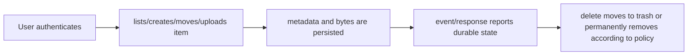

# Storage Domain and Data Lifecycle

- Status: As-built baseline
- Date: 2026-09-21
- Catalog capability ID: `storage-domain-and-data-lifecycle`
- Last verified: `603d84a2f88297c9e7fd1b7143df3980fb21e24d` (2026-09-20 UTC)
- Owners: VaultStadio maintainers
- Scope: Define files, folders, metadata, ownership, quotas, trash, storage backends, and content lifecycle.
- Related issues/PRs: #71, #124, #91
- Required review gates: product UX, architecture, testing, documentation, security/operations
- Open decisions blocking readiness: see the explicit decisions and limitations below

## 1. Executive summary

Storage is the product core. This baseline separates metadata lifecycle from byte storage and records how local and S3-compatible backends are selected.

This document is an integrated product and engineering contract. For an as-built baseline, it records current behavior and the contract maintainers choose to preserve; it does not by itself authorize a behavior change.

## 2. Problem, current behavior, and evidence

### 2.1 Problem

Storage documentation uses inconsistent environment prefixes and mixes backend selection with protocol exposure. It does not provide one lifecycle contract for create, move, delete, trash, restore, quota, and backend failures.

### 2.2 Current behavior

The backend has domain/core/application storage modules, local and S3 backends, storage routes, metadata, quotas, trash/starred operations, and configuration-driven backend selection.

### 2.3 Evidence

- `backend/domain/storage`
- `backend/core/storage`
- `backend/application/storage`
- `backend/infrastructure/src/main/kotlin/com/vaultstadio/infrastructure/storage`
- `backend/api/src/main/kotlin/com/vaultstadio/api/config/AppConfig.kt`
- `backend/api/src/main/kotlin/com/vaultstadio/api/config/Koin.kt`
- `docs/operations/STORAGE_CONFIGURATION.md`
- `docs/operations/BACKUP_RESTORE.md`

### 2.4 Retrospective classification

- **Observed behavior:** the current behavior described above is supported by the listed checkout evidence.
- **Intentional contract:** only the invariants and acceptance scenarios in this SDD are proposed for preservation; historical motivation is not inferred.
- **Known debt and limitations:** documentation/source mismatches, incomplete external verification, and explicitly named unsupported operations remain debt until closed.
- **Unknown rationale:** historic reasons for the current structure are unknown unless a source reference states them.
- **Proposed improvements:** any future change is listed in the implementation sequence and must not be read as implemented behavior.

### 2.5 Audit checkpoint — 2026-10-25

El recorrido básico LOCAL y la restauración de bytes pasan. A01/A02/A08/A11 confirman huecos de ownership de carpeta, cuota, arranque S3/MINIO y validación de nombres. La aceptación de cuota no está satisfecha.

Evidencia parcial de producto en master `615f11adf5272bd1d4626f9571b31e691eeee062`: [auditoría integral](../docs/development/REPOSITORY_AUDIT_2026-10-25.md), [resultados saneados](../docs/development/audits/2026-10-25/verification-summary.json) y [roadmap](../docs/development/AUDIT_ROADMAP_2026-10-25.md), issue #71. Este checkpoint no modifica el estado declarado ni sustituye la verificación original de la baseline.

## 3. Actors, surfaces, and terminology

| Actor | Goal | Entry point | Visible surfaces |
|---|---|---|---|
| End user | Use the capability safely | REST/API or frontend | response, screen, error/recovery state |
| Administrator/operator | Configure, diagnose, recover | configuration, Docker/Helm, admin API | logs, health, reports, retained state |
| Contributor | Change the capability without boundary drift | backend/frontend source | tests, SDD, CI, docs |
| External client/provider | Interoperate through an explicit contract | protocol adapter | bounded request/response or failure |

**Capability:** the user-visible behavior owned by this SDD. **Semantic port:** an application-facing capability interface that does not expose provider DTOs or transport clients. **Composition root:** the explicit boundary where concrete adapters and credentials are wired. **Retained state:** facts that remain after a failure and determine safe recovery.

## 4. Goals, non-goals, and fixed invariants

### 4.1 Goals

1. Define authoritative metadata and byte ownership.
2. Make backend selection and S3 API exposure explicit.
3. Specify lifecycle invariants for ownership, paths, quotas, trash, and restore.
4. Preserve consistency across local and S3 implementations.

### 4.2 Non-goals

1. No storage backend is treated as interchangeable without contract tests.
2. No silent data loss on partial metadata/byte failure.
3. No claim of distributed consistency beyond verified behavior.

### 4.3 Fixed product and safety invariants

1. Every stored item has an owner and valid parent/path relationship.
2. Metadata and content operations have explicit failure/compensation behavior.
3. Quota and authorization are checked before mutation.
4. Backend-specific details remain behind storage ports.

## 5. Current versus proposed product journey

| Stage | Current/observed | Contract to preserve or implement | User/operator effect |
|---|---|---|---|
| Entry | User authenticates | Validate identity, input, and configuration before mutation | Invalid work is rejected early |
| Operation | lists/creates/moves/uploads item | Apply one bounded semantic use case | Progress and ownership are explicit |
| Outcome | delete moves to trash or permanently removes according to policy. | Return success, partial, or failure with retained state | Next action is inspectable |

Text equivalent: User authenticates -> lists/creates/moves/uploads item -> metadata and bytes are persisted -> event/response reports durable state -> delete moves to trash or permanently removes according to policy..

## 6. Functional behavior and state model

### 6.1 Happy path

1. The entrypoint validates the request and resolves the capability owner.
2. The application policy evaluates invariants and calls semantic ports in an explicit order.
3. Adapters perform bounded external I/O and map provider results to semantic facts.
4. The presentation surface reports completed facts, current state, next action, and safe evidence.

### 6.2 Alternative, duplicate, stale, and partial paths

- Duplicate requests MUST be idempotent or return an explicit duplicate outcome.
- Stale, out-of-order, canceled, and partially completed operations MUST retain enough state for a safe retry or a clear terminal action.
- A provider failure MUST NOT be converted into an empty success result.
- If an irreversible effect completed before a later step failed, the result MUST distinguish completed effects from pending recovery.

### 6.3 State machine

| State | Trigger/condition | Owner | Allowed next states |
|---|---|---|---|---|
| `active` | Item is visible and usable | user | read/update/share |
| `trashed` | Item retained but hidden from normal listing | user | restore/delete |
| `restored` | Item returned to active hierarchy | user | use/share |
| `deleted` | Metadata and bytes removed per policy | operator | backup/recovery only |
| `degraded` | Metadata/content operation partially completed | operator | reconcile/retry |

### 6.4 Ownership correction contract — issue #73

This revision restores the authorization-before-mutation invariant. It is an implementation contract for the following subset; the wider baseline is not declared implemented.

| ID | Required behavior | Denied/failure retained state |
|---|---|---|
| STO-AUTH-01 | Ordinary authenticated reads and mutations MUST require `item.ownerId == actor.id`, for PRIVATE, PUBLIC and SHARED alike. Visibility is not an access grant. | No metadata, bytes or events change. |
| STO-AUTH-02 | Create-folder, get-or-create, upload, move, copy and restore MUST resolve an owned, active folder destination and owned, active folder ancestors before name lookup or any effect. Root is the actor's implicit root. | Original hierarchy, stream and backend remain untouched. |
| STO-AUTH-03 | Foreign destinations MUST return `ACCESS_DENIED`/403 before type, trash state or names are disclosed. Missing destinations return 404; owned invalid/trashed destinations return 400. | No name lookup, metadata write, byte write/copy or event. |
| STO-AUTH-04 | Get-or-create MUST validate an existing result's ownership, folder type and active state before returning it. | No foreign or trashed folder is returned or replaced. |
| STO-AUTH-05 | Breadcrumbs MUST authorize each ancestor before returning any ancestor metadata, including historically inconsistent cross-owner hierarchies. | Whole request fails; no partial ancestor list is disclosed. |
| STO-AUTH-06 | Hierarchy traversal MUST detect cycles, reject more than 128 ancestors, and reject moving an item into itself or a descendant before effects. | Original parent/path/version remain unchanged. |
| STO-AUTH-07 | Permanent deletion MUST remove a single leaf only. A nonempty folder MUST be rejected atomically against concurrent child insertion, including legacy cross-owner descendants. The atomic leaf port MUST revalidate the owner and retain its item lock through the content callback and metadata deletion, using the locked storage key; implicit SQL cascade is not an authorized recursive operation. | Parent, descendants and content remain. Empty-folder and owned-file deletion retain existing behavior. |
| STO-AUTH-08 | Repository failures MUST retain their typed identity; a failed authorization/preflight MUST invoke no mutating repository, backend or event operation. | Caller can distinguish failure from successful empty results. |

| Surface | Owner | Other authenticated actor | Validated share token |
|---|---|---|---|
| Normal metadata/download/list | Allowed by item type | Denied for every visibility | Separate share use case only |
| Create/get-or-create/upload under parent | Owned active folder chain | Denied before name/content access | No write grant |
| Rename/move/copy/star/trash/restore/delete | Owner; destination/leaf constraints apply | Denied | No write grant |
| Breadcrumbs | All ancestors owned | Denied without partial metadata | No ancestor grant |

Local verification for this subset: [issue #73 report](../docs/development/verification/STORAGE_OWNERSHIP_73.md), source commit `260489a0131419cc1c1231d952681c81d067c802`. Remote review/CI/merge and the rest of the baseline remain separate gates.

No permission switch is configurable. Token-authorized public downloads keep their existing validation and owner-scoped download path; changing sharing semantics is outside this correction.

### 6.5 Collaboration access to canonical files — issue #89

R01c reuses StorageAccessPolicy.requireOwner before collaboration metadata or effects, then rejects non-FILE/trashed canonical items. A storage download grant does not confer historical or collaboration permission. Document and comment writes recheck authority under item-before-document/comment locks; snapshot saves reject intervening changes. Membership admission/leave/update rechecks the current item owner under the canonical item/session lock, while presence references are validated against their canonical resources. The complete scope, risk inventory and explicit missing cold-start/canonical-commit journeys are in [SDD-0009§6.4](SDD-0009-real-time-collaboration.md#64-collaboration-authorization-repair--issue-89); ordinary storage semantics and the reviewed R01 storage deletion boundary remain unchanged. Local verification passes the2740-case backend gate; [evidence](../docs/development/verification/COLLABORATION_AUTHORIZATION_89.md) separates snapshot persistence from canonical commits, which remain#112/#109. Remote CI/review/adoption are pending.

### 6.6 Storage selection validation — issue #91

Domain owns validated REST selections, with limit1..1000/offset0..Int.MAX_VALUE; core checks before any parent/storage query. Preserve ownership/parent/trash constraints and typed failures. SQL adds id ASC after the requested primary and existing TYPE/name ordering. Shared PagedResult computes exact Long metadata without overflow; raw protocol query/limit<=0 compatibility is retained. The complete lexical/default/bounds/compatibility and160-backend-plus8-client risk contract is [SDD-0002§6.5](SDD-0002-public-api-and-protocol-contract.md#65-bounded-storage-selections--issue-91), committed before code. Numeric page fields widen consistently to int64 across the server/client boundary; ordinary JSON values stay unchanged. This is a scoped contract, not whole-capability acceptance.

### 6.7 Critical authenticated file-journey coverage — issue #119

Pre-implementation contract (2026-10-27), CLIENT119-STORAGE: exercise the existing authenticated read/transfer/mutation/trash routes with production services, migrated PostgreSQL and owned temporary content. Verify returned identifiers and bytes, current rows/content after success, and zero forbidden effects after rejection. Client request-adapter tests must preserve each method, path, query, typed payload, multipart bytes and failure without claiming that an unimplemented server protocol is operational. Cancellation remains control flow; absent required payload/failed I/O cannot become an empty or Unit success.

Incoming body consumption is part of transfer cancellation semantics, including successful HTTP responses whose Ktor body channel fails with a wrapped cancellation. File/folder/chunk uploads and binary download must use the same transport cancellation policy as BaseApi. Preserve caller cancellation even when wrapped; actual request/connect/socket deadlines remain network failures. Test both kinds independently. This refinement follows four executed negative body-channel controls before implementation.

STO119-01–20 in [the scenario inventory](../docs/development/verification/critical-coverage-119-scenarios.json) cover these boundaries. Existing S3/WebDAV, authenticated UI download, search, version recovery and advanced-capability debts retain their own issues; this increment must neither exclude them from canonical coverage nor certify their readiness using a transport fixture.

### 6.8 Accepted product discovery — issue #124 (2026-10-29)

These are **accepted product targets, proposed for implementation**. They do not change the observed baseline, catalog status or last-verified evidence. The [discovery index](discovery/2026-10-29/README.md) retains the source answers and cross-capability dependencies; this SDD owns the requirements below.

#### PD-004: Personal files and shared spaces in one community

One installation MUST support personal files per user and family/team shared spaces in one community of users. Shared-space membership and content permissions require explicit modeling; this decision does not introduce isolated multi-tenant organizations or replace existing owner checks with implicit access.

**Blocking technical decisions:** Space ownership, membership lifecycle, role matrix, transfers of ownership, hierarchy boundaries and user-versus-space charging.

#### PD-012: Configurable trash retention

Trash retention MUST default to 30 days and support administrator configuration, space/vault overrides and explicit indefinite retention. Content is eligible for automatic expiry only under its effective retention policy; quota pressure does not override indefinite/protected retention.

**Blocking technical decisions:** Trash timestamp/clock boundary, holds, child hierarchy, concurrent restore/purge, policy changes on existing trash, backup interaction and physical reclamation consistency.

#### PD-014: Quota includes current content, trash and history

Quota MUST account for current content, trash and historical versions, displaying each category separately and their coherent total. Moving data between categories does not make its stored consumption disappear.

**Blocking technical decisions:** Charging owner, byte units, reservations for partial uploads, replica overhead, reference sharing, reconciliation and transactional category transitions.

#### PD-015: Quota exhaustion without destructive admission

Administrators MUST be able to select block-growth without admission-driven purge; cleanup of already retention-eligible trash/history then block growth if still insufficient; or bounded temporary overage while physical capacity permits. The cleanup-then-block strategy is the default. No strategy may delete active content or protected historical versions.

**Blocking technical decisions:** Reservations/concurrent admissions, eligible-cleanup partial effects, overage bounds/expiry, notifications, physical-space reserve and policy revisions during uploads.

#### PD-020: Resource-dependent configurable redundancy

Administrators MUST be able to configure redundancy according to available resources. One underlying disk cannot provide product-level redundancy; additional disks may make protection possible. No unconditional two-copy default or authority over independent installations is implied.

**Blocking technical decisions:** Resource discovery/attestation, replica versus erasure coding, capacity calculation, repair, acknowledgement durability and provider-managed redundancy evidence.

#### PD-021: Disk and whole-server failure domains

Where resources permit, the product MUST offer protection against disk and whole-server failures and show exactly which failures the selected placement protects against. Copies on separate disks in one server do not protect against losing that server.

**Blocking technical decisions:** Failure-domain identity, correlated failures, topology changes, recovery point/durability guarantees, replica placement and evidence of resource independence.

#### PD-022: Safe default while redundancy is degraded

Degraded-redundancy behavior MUST be administrator-configurable with space/vault overrides. By default, allow authorized reads of available content and block writes unable to satisfy the configured protection. Explicit alternative degraded writes must disclose reduced protection and repair state.

**Blocking technical decisions:** Fault detection, fenced write acknowledgements, policy changes during writes, repair/rebalance, split brain and resumption conditions.

#### PD-030: Automatic placement with constrained user server choice

Placement MUST be automatic by default and allow a user to select an authorized server only when the space/vault policy and required redundancy permit it. Administrators configure behavior and constraints. A user preference cannot override content grants, eligible resources or protection requirements.

**Blocking technical decisions:** Placement algorithm, capacity reservations, primary-versus-replica preference semantics, topology changes, rebalance/migration and independent peer write authorization.

## 7. User-facing configuration

Storage type, local path, S3 endpoint/region/bucket/credentials, path style, quota, and trash retention are validated with cross-field rules. Storage type controls backend and S3 route registration.

Configuration MUST define type, recommended default, allowed values, validation, precedence, persistence/snapshot behavior, migration for unknown or retired values, and values that are intentionally not configurable. A configuration change MUST update the relevant docs and contract tests.

### Accepted target configuration (#124)

| Requirement | Authority, default and inheritance |
|---|---|
| PD-004 | Users use personal storage and explicitly granted shared spaces. Membership roles, creation/delegation rights and defaults are unresolved, not open access. |
| PD-012 | General 30-day default; explicit administrator space/vault override wins; indefinite is a distinct value, not an accidental zero/overflow. Bounds and deletion-clock semantics require design. |
| PD-014 | All three categories count by default. User-versus-shared-space charging, logical/physical units, replicas, deduplication and encryption overhead need explicit decisions before billing/admission claims. |
| PD-015 | General administrator default with space/vault overrides. Temporary-overage amount/duration and physical reserve require explicit bounds; selecting a strategy cannot negate retention or content grants. |
| PD-020 | Administrator-selected redundancy constrained by eligible disks/servers and capacity. Activation default with multiple disks, replica count and coding scheme remain undecided. |
| PD-021 | Administrator-selected disk/server protection level, constrained by verified independent resources. Server failure coverage is separate from primary-service availability under PD-023. |
| PD-022 | Default reads allowed/under-protected writes blocked; explicit space/vault policy overrides the general setting within authorization and actual resource constraints. |
| PD-030 | Administrator automatic-placement default with optional permitted user server choice at space/vault scope. A selected server is subject to independent-installation write grants and required replica placement. |

These are product-policy semantics, not new environment variable/API field names. Before implementation, define typed validation/bounds, persistence, effective policy revision for pending work and migration/rollback. An override cannot bypass content authorization, E2EE boundaries or protected retention. Unknown/invalid policy is not permission to select a weaker default.

## 8. Clean Architecture design

### 8.1 Responsibilities and dependency direction

| Boundary | Owns | Must not own/import |
|---|---|---|
| Domain/pure policy | Storage Domain and Data Lifecycle invariants and provider-independent decisions | Ktor, Compose, database, SDK, process, or credentials |
| Application | use cases, semantic ports, ordering, typed outcomes | concrete transport/provider clients or raw DTO policy |
| Adapters/data | protocol mapping and external I/O | product policy or cross-capability orchestration |
| Infrastructure/composition | concrete clients, credentials, Koin/wiring, deployment | hidden business decisions |
| Entrypoints/presentation | input adaptation, state rendering, navigation/HTTP mapping | duplicated domain mutation policy |

### 8.2 Contracts, state, and trust boundaries

Storage domain owns item/value invariants. Application owns use cases and storage ports. Local/S3 adapters own byte operations. API maps requests/responses. Koin is composition only.

A storage port must not expose SDK clients or filesystem primitives to application policy. Local and S3 adapters share semantic contract tests.

For STO-AUTH-07, `deleteLeaf(id, actorId, deleteContent)` is a semantic atomic port: the SQL adapter owns the row lock and transaction, invokes the domain ownership policy on its locked snapshot, rejects non-leaves before invoking the callback, and returns that same snapshot after metadata deletion. Core owns byte deletion inside the callback and publishes success only after the port succeeds. No SQL transaction/client type crosses the port. The per-item lock deliberately remains held during byte I/O to prevent the reviewed check/delete race; slow provider I/O and post-content database commit failure remain reasons to implement a durable compensation/outbox lifecycle in R02, not claims of cross-resource atomicity in this correction.

### 8.3 Executable architecture constraints

- Application and domain imports MUST be checked for forbidden transport, framework, process, SDK, and provider dependencies.
- Every concrete adapter MUST have focused contract tests and every public route/workflow MUST have an owning SDD/evidence entry.
- The validator MUST report missing evidence rather than infer success from file existence alone.
- RepoWise and Graphify results MAY guide investigation but MUST NOT be used as the sole acceptance criterion.

## 9. UI/UX and content contract

Primary user-facing states MUST show current status, completed facts, next action, impact, inspectable links, and progressively disclosed technical evidence. Machine identifiers and protocol paths remain stable and English.

Errors and partial results use the order **impact -> cause -> action -> retained state**. Technical identifiers, URLs, and protocol names remain stable. Visual diagrams are supplementary; the state tables and text above are normative.

## 10. Failure, recovery, and cleanup

If metadata and bytes diverge, the operation reports retained state and recovery action; it never reports success solely because one side completed.

| Failure/partial state | Impact | Retained facts | Automatic retry | Required action | Cleanup |
|---|---|---|---|---|---|
| Invalid input/configuration | No operation starts | validation result | No | Repair input/config | None |
| Provider/storage failure | Operation may be partial | operation ID and completed effects | Bounded only if safe | Inspect and retry/reconcile | Release transient resources |
| Stale/duplicate request | No unsafe overwrite | authoritative current state | Safe replay if idempotent | Re-read and retry | None |
| Cancellation/timeout | Work may be incomplete | session/state/phase | Explicit | Resume, cancel, or recover | Expire owned transient state |

## 11. Security, permissions, and privacy

Path traversal, symlink escape, bucket abuse, ownership bypass, secret leakage, and quota exhaustion are boundary threats.

Untrusted content MUST remain data. Secrets, credentials, private content, raw provider responses, and stack traces MUST NOT appear in public errors, logs, generated docs, fixtures, or catalog evidence.

## 12. Observability and operational UX

Record operation, item ID, backend kind, bytes, duration, and correlation; never paths containing secrets or access keys.

Operator evidence MUST distinguish liveness, readiness, dependency failure, configuration failure, and retained partial state. Correlation IDs and stable semantic codes are preferred over raw exceptions.

## 13. Compatibility, migration, rollout, and rollback

Existing behavior is preserved for an as-built baseline unless a future revision explicitly changes the contract. Any behavior-changing migration MUST define in-flight state, rollback, and compatibility evidence.

For this baseline, the initial rollout is documentation and validation only. Future implementation work MUST state whether it is greenfield, backward-compatible, migratory, or breaking, and MUST define rollback for every irreversible effect.

The #73 correction rejects formerly accepted unauthorized writes and implicit nonempty-folder cascades. It performs no data rewrite or migration. Legacy cross-owner rows remain available for an explicit repair; they MUST NOT be reassigned or deleted automatically. Operators can recover individual owned children before deleting an empty folder. Rolling back the code restores the vulnerability and is not the recommended recovery; retain data and correct forward. Full recursive metadata/content deletion remains lifecycle work beyond this authorization fix.

## 14. Testing strategy and numeric budget

Minimum risk-derived budget: **Minimum 28 cases: item invariants, ownership, path validation, quota, local backend, S3 backend, create/move/delete/trash/restore, metadata failure, byte failure, consistency, authorization, and cleanup.**

The budget is a floor, not a substitute for covering every normative requirement. Tests SHOULD include pure policy tests, application/use-case tests, adapter contract tests, route/workflow/schema tests, security/abuse tests, and integration or human evidence where automation cannot establish the contract. No live external service is required for deterministic unit tests; authorized external smoke evidence MUST be labelled separately.

For #73, the minimum additional budget is 64 executed cases: all three visibilities across denied parent writes and source mutations; owner success; missing/type/trash destinations; invalid existing get-or-create result; ancestor ownership/cycle/depth; move-cycle prevention; typed failures and zero-effect checks. Real production-route tests MUST use the production use cases/service, local byte adapter, PostgreSQL and the Flyway schema (including its actual cascade), assert status/body and unchanged rows/bytes, and include an owner success control. Pure policy branches target 100% line and branch coverage; aggregate coverage is reported separately without claiming the full platform meets that target.

VFY-DBTIME-01 in SDD-0014 requires complete persisted fixture baselines and two explicit nanosecond-input regressions. PostgreSQL timestamps have microsecond resolution; the fixture MUST read back the adapter's persisted representation before asserting that a denied or failed operation changed no metadata. These tests retain exact full-row equality, including timestamps, and do not alter production persistence semantics.

For #124, add at least **24 future acceptance families** (8 decisions × positive, denied/invalid and failure/recovery). The concrete families are listed in §16; they are **planned, not executed tests**. Expand actor, policy, boundary, concurrency, platform and cryptographic matrices before the affected implementation is marked ready. Preserve existing regression budgets.

## 15. Documentation and discoverability

| Audience | Required artifact | Purpose |
|---|---|---|
| User/client | API or frontend guide | Normal journey, defaults, examples, visible states |
| Operator | configuration/recovery/runbook | prerequisites, health, failure, retry, cleanup |
| Contributor | this SDD and architecture guide | boundaries, contracts, tests, implementation order |
| Maintainer | catalog and traceability | ownership, verification commit, unresolved decisions |

The owning user-facing documentation MUST link back to this SDD or its catalog entry. Examples MUST be checked against current code or contract fixtures.

## 16. Acceptance scenarios

1. Given `STORAGE_TYPE=LOCAL`, when the application starts, then S3 routes are not registered.
2. Given a quota-exceeding upload, when the request is handled, then no partial item is reported as complete.
3. Given a trashed item, when it is restored, then ownership/path/quota rules are revalidated.

4. Given A's folder and actor B, creating/get-or-creating/uploading beneath it fails for PRIVATE/PUBLIC/SHARED; no name lookup, bytes, row or event is produced (STO-AUTH-01–03,08).
5. Given an owned source and foreign, trashed or non-folder destination, move/copy/restore fails with original source/version/content retained (STO-AUTH-02–03).
6. Given an existing get-or-create result that is foreign, trashed or a file, the result fails before mutation (STO-AUTH-04).
7. Given an owned item with a foreign ancestor, breadcrumbs fail without returning names; cycles and a 129th ancestor fail without effects (STO-AUTH-05–06).
8. Given a nonempty folder in the real migrated schema, permanent delete fails and both owned/foreign children survive. A child insertion racing a file or empty-folder delete must not be silently cascaded; if insertion wins, the original bytes remain (STO-AUTH-07).
9. Given any preflight port failure, its original typed error reaches the caller and no mutation/backend/event is invoked (STO-AUTH-08).

### Planned discovery acceptance (#124)

- **PD-004-P** — Two users retain separate personal files and can access a shared file only after an explicit applicable grant.
- **PD-004-N** — A nonmember, removed member or unrelated administrator cannot list/read/mutate private space content by guessing its ID.
- **PD-004-F** — A failed membership change or interrupted move across spaces preserves authoritative grants and recoverable bytes; no mixed-authority hierarchy appears.

- **PD-012-P** — With a controlled clock, verify 30-day default eligibility, a finite override and indefinite retention while preserving restorable content before eligibility.
- **PD-012-N** — Quota cleanup or an unauthorized policy edit cannot remove noneligible, indefinitely retained or protected content.
- **PD-012-F** — A purge interrupted between metadata and bytes reports retained effects and permits safe reconciliation without claiming reclaimed capacity twice.

- **PD-014-P** — Upload, version and trash known payloads; verify category subtotals and the total against authoritative storage/accounting facts after each transition.
- **PD-014-N** — Trash/version transitions or duplicate requests cannot evade quota, double-charge shared bytes under the chosen model or expose another user's usage details.
- **PD-014-F** — A failed accounting transition or concurrent reservation does not allow unaccounted growth; reconciliation retains bytes and reports discrepancies.

- **PD-015-P** — Exercise all strategies with known eligible and protected data; default reclaims only eligible content and blocks/notifies when that remains insufficient.
- **PD-015-N** — Concurrent over-quota uploads, unavailable physical capacity and active/protected deletion attempts cannot bypass admission or erase protected data.
- **PD-015-F** — A failed cleanup reports actual reclaimed/retained bytes, preserves protected content and never admits growth based on a failed or duplicated reclamation count.

- **PD-020-P** — Discover one and several eligible disks; show no product-level redundancy on one and only feasible configurable protection on the larger topology.
- **PD-020-N** — Two paths/partitions on the same underlying disk cannot be counted as independent protected copies.
- **PD-020-F** — A missing/misidentified disk or failed replica allocation leaves the operation under-protected/failed explicitly, never a false protected acknowledgement.

- **PD-021-P** — Lose one disk and then an entire eligible server in separate campaigns; verify readable hashes and displayed coverage against the declared topology.
- **PD-021-N** — A same-host two-disk configuration cannot claim whole-server protection or acknowledge a placement that violates the selected domain requirement.
- **PD-021-F** — A domain disappears or changes identity during allocation/repair; record actual remaining protection and retain recoverable copies without a false healthy state.

- **PD-022-P** — Lose a copy: available authorized reads succeed, default under-protected writes fail, and an explicitly permitted alternative reports its actual durability.
- **PD-022-N** — Stale health or a user-selected server cannot bypass required protection; degraded mode never broadens content permissions.
- **PD-022-F** — Fail repair or partition the network during a write; retain acknowledged data and report unresolved protection without unsafe duplicate/current-state commits.

- **PD-030-P** — Upload without preference and with an allowed server choice; verify actual placement, required copies, content hashes and returned source identity.
- **PD-030-N** — A forbidden/full/untrusted server or preference incompatible with required protection is rejected before admitting bytes or reserving unauthorized capacity.
- **PD-030-F** — Lose the selected server or change policy during upload: retain resumable data and report the actual outcome; any fallback must remain explicitly policy-authorized.

## 17. Requirements traceability

| Requirement | Owner | Verification target | Documentation |
|---|---|---|---|
| Fixed invariants | Domain/application policy | focused policy and architecture tests | this SDD |
| Public behavior | Use case and adapter | route/protocol/integration tests | API/frontend/operations reference |
| Failure and recovery | Application outcome policy | partial, retry, cancellation, and cleanup tests | troubleshooting/recovery guide |
| Security/privacy | boundary policy and composition | abuse, secret-safe, and permission tests | security guide and threat model |
| Operational evidence | workflow/deployment adapter | render, health, artifact, and rollback checks | operations runbook |

Issue #73 evidence targets: domain `StorageAccessPolicy`; core `StorageHierarchy` and storage query/write/mutation helpers; `StorageParentAuthorizationTest`, `StorageMutationAuthorizationTest`, `StorageHierarchyTest`; production-route `StorageOwnershipIntegrationTest` and leaf-delete concurrency adapter tests. Exact paths and measured results are recorded in the linked PR after verification; targets alone do not establish completion.

### Discovery traceability (#124)

| Requirement owner in §6 | Planned acceptance in §16 | Implementation/evidence state | Milestone |
|---|---|---|---|
| [PD-004](#pd-004) | PD-004-P / -N / -F | Accepted target; implementation and current execution evidence still required | [M2](../docs/development/PRODUCT_ROADMAP_2026-10-29.md#m2) |
| [PD-012](#pd-012) | PD-012-P / -N / -F | Accepted target; implementation and current execution evidence still required | [M2](../docs/development/PRODUCT_ROADMAP_2026-10-29.md#m2) |
| [PD-014](#pd-014) | PD-014-P / -N / -F | Accepted target; implementation and current execution evidence still required | [M2](../docs/development/PRODUCT_ROADMAP_2026-10-29.md#m2) |
| [PD-015](#pd-015) | PD-015-P / -N / -F | Accepted target; implementation and current execution evidence still required | [M2](../docs/development/PRODUCT_ROADMAP_2026-10-29.md#m2) |
| [PD-020](#pd-020) | PD-020-P / -N / -F | Accepted target; implementation and current execution evidence still required | [M4](../docs/development/PRODUCT_ROADMAP_2026-10-29.md#m4) |
| [PD-021](#pd-021) | PD-021-P / -N / -F | Accepted target; implementation and current execution evidence still required | [M4](../docs/development/PRODUCT_ROADMAP_2026-10-29.md#m4) |
| [PD-022](#pd-022) | PD-022-P / -N / -F | Accepted target; implementation and current execution evidence still required | [M4](../docs/development/PRODUCT_ROADMAP_2026-10-29.md#m4) |
| [PD-030](#pd-030) | PD-030-P / -N / -F | Accepted target; implementation and current execution evidence still required | [M4](../docs/development/PRODUCT_ROADMAP_2026-10-29.md#m4) |

## 18. Implementation or maintenance sequence

Freeze domain lifecycle -> reconcile configuration names -> write backend contract tests -> validate local/S3 parity -> update protocol and operation docs.

Discovery targets follow the dependency order and evidence gates in the [2026-10-29 roadmap](../docs/development/PRODUCT_ROADMAP_2026-10-29.md). Each implementation requires its own admitted, bounded issue/PR; this documentation revision does not activate or certify these features.

## 19. Definition of Done

- [ ] Every normative requirement has acceptance and traceability.
- [ ] Current behavior, intentional contract, debt, unknowns, and proposals are separated.
- [ ] Architecture boundaries and configuration validation are executable.
- [ ] Numeric test budget and all applicable failure/security cases pass.
- [ ] User, operator, contributor, and migration documentation is synchronized.
- [ ] Catalog evidence points to the verified commit and all referenced paths exist.
- [ ] `python3 scripts/validate-specification-catalog.py` passes.
- [ ] `git diff --check` passes and no generated or secret-like artifact is staged.
- [ ] No readiness-blocking decision remains unresolved for the declared status.

## 20. References and decisions

- `backend/core/storage/src/main/kotlin/com/vaultstadio/core/domain/service/StorageService.kt`
- `backend/infrastructure`
- `docs/operations/STORAGE_CONFIGURATION.md`

- Portfolio governance: `SDD-0000-architecture-quality-and-product-contract.md`.
- Related capability contracts are listed in `specs/catalog.json`.

## Scoped verification checkpoint — issue #91

The pre-code selection contract is implemented and locally verified at1499c6b. See the [source-bound report](../docs/development/verification/STORAGE_SELECTION_91.md), case inventory and complete coverage detail:3247backend+1324desktop+1200browser, all failures/errors/skips0;266 genuinely new backend cases plus8 shared KMP cases per platform. Actual packaged browser sort and400/recovery pass with original data/rollback preserved. The unavailable content option is explicit501; full filename/advanced search remains#82/#115, and Web origin configuration#116. Final PR CI, Copilot review and protected adoption remain pending; this checkpoint does not promote the whole capability status or master.

Review supplement63e12a1 adds two actual PostgreSQL fault controls, retaining the production implementation. Current local inventory3249backend+1324desktop+1200Wasm=5773, all0; see [actual dependency/SQL evidence](../docs/development/verification/STORAGE_SELECTION_91_REVIEW.md). The original5771-case source archive remains historical; fresh final-head CI/review/adoption are separate.

Discovery provenance and ownership: [30 accepted decisions](discovery/2026-10-29/README.md), [verbatim answers](discovery/2026-10-29/answers.json), [issue #124](https://github.com/vypdev/vaultstadio/issues/124).

## Supported publication-format supplement — #145, 2026-10-30

This append-only supplement renders the existing §5 journey and §9 presentation
contract. It preserves the preceding historical text, readiness, open decisions
and verification receipts. The examples below are contract examples, not newly
implemented screens or executed runtime acceptance.

Text equivalent: User authenticates -> lists/creates/moves/uploads item -> metadata and bytes are persisted -> event/response reports durable state -> delete moves to trash or permanently removes according to policy..

Representative state content (apply the evidence limitations in §2 and §17):

- Pending: Saving file metadata and content under the owning account.
- Action required: Inspect the retained item identity before retrying a failed mutation.
- Blocked: Invalid ownership, path or quota prevents the mutation.
- Partial: Metadata/content effects differ; retained state requires reconciliation.
- Complete: The requested item mutation and its declared durable effects are confirmed.

The following allocation restates the original §14 base floor. Later scoped
matrices, discovery families, concurrency controls and higher budgets in the
preceding contract remain additional requirements; this table neither replaces
them nor claims that these cases ran during the format migration.

| Existing base risk area | Minimum distinct cases |
|---|---:|
| Item/ownership policy | 8 |
| Storage adapters | 8 |
| Lifecycle operations | 8 |
| Partial failure/cleanup | 4 |
| **Total** | **28** |

Acceptance/traceability remains in §16–17. Actual implementation must reconcile
those requirements and all later scoped matrices before claiming completeness.
