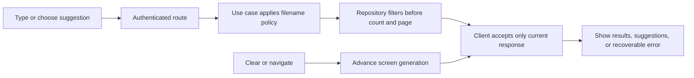
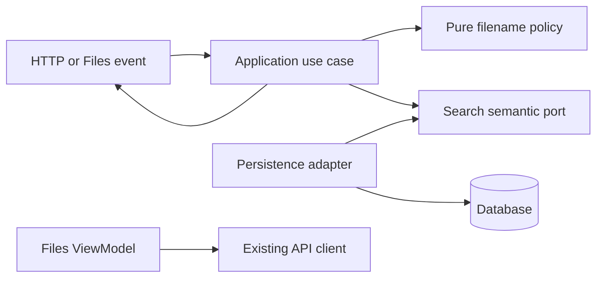

# Filename Search and Suggestions — Issue #82 Companion

- Status: Draft
- Date: 2026-10-30
- Catalog capability ID: `metadata-search-and-ai`
- Last verified: not applicable; proposed contract, not an implementation verification
- Owners: VaultStadio maintainers
- Scope: Specify literal filename contains search, literal prefix suggestions, and client freshness for the existing metadata-search-and-ai capability.
- Related issues/PRs: [Issue #82](https://github.com/vypdev/vaultstadio/issues/82); related owning API and storage contracts are SDD-0002 and SDD-0004; primary capability owner is `specs/sdd-0012-metadata-search-and-ai.md`.
- Required review gates: product UX, architecture, testing, documentation, security/operations
- Open decisions blocking readiness: none for this bounded contract. Implementation readiness still requires review of this Draft and Action verification of its exact linked managed branch.

## 1. Executive summary

Files search MUST match a literal query anywhere in an eligible filename; suggestions MUST match a literal prefix. Matching ignores case and accents, keeps ñ distinct from n, and treats canonically equivalent Unicode forms consistently. `%`, `_`, and `\\` are literal characters. Results preserve original names, IDs, metadata, and bytes. Owner and non-trash constraints remain mandatory. Filtering and totals precede pagination. A client response may update the screen only while it belongs to the current query, suggestion prefix, folder, and view state.

```text
Type query -> filter owned, non-trashed filenames -> show stable paged matches and literal-prefix suggestions -> accept only current responses
```

This companion is scoped to filename search and suggestions. It does not claim full-text, OCR, or AI search, and does not change the broader Proposed status or portfolio in the primary SDD.

## 2. Problem, current behavior, and evidence

### 2.1 Problem

People using Files cannot rely on nonempty search text to narrow results or suggestions. Irrelevant entries obscure the requested file and can mislead users across folder and search transitions. Search must not disclose another owner's items or include trashed items.

### 2.2 Current behavior

1. `StorageService.search` supplies `searchQuery` in `StorageItemQuery`.
2. The current `ExposedStorageItemRepository.query` constructs owner, parent, type, trashed, and starred predicates but omits `searchQuery`.
3. Suggestions reuse generic search without applying a prefix policy.
4. `FilesViewModel` starts independent search and suggestion requests without freshness guards. A real delayed-response reproduction showed an old response replacing the restored folder list after clear. Cancellation alone is not a sufficient freshness guarantee.
5. In the adopted baseline, authenticated HTTP calls with nonempty `q` and `prefix` returned all eight owned nontrashed fixtures instead of the expected two contains matches and one prefix match. The browser showed the same defect. A delayed old response replaced the folder listing after clear; visible Refresh recovered it.

### 2.3 Evidence

- Immutable adopted baseline: develop `380c14734eb4354c6223d165b2416ba7bd27d2f6`, tree `0e883a0e858b4429f9c64bcc4ecc0a611bab69fc`.
- Source observations: `backend/core/storage/src/main/kotlin/com/vaultstadio/core/domain/service/StorageSelections.kt`; `backend/infrastructure/src/main/kotlin/com/vaultstadio/infrastructure/persistence/StorageItemSelection.kt`; `backend/api/src/main/kotlin/com/vaultstadio/api/routes/metadata/SuggestionRoutes.kt`; `frontend/feature/files/src/main/kotlin/com/vaultstadio/app/feature/files/FilesViewModel.kt`.
- Existing route test: `backend/api/src/test/kotlin/com/vaultstadio/api/routes/SearchRoutesTest.kt`.
- Historical authenticated HTTP and real browser reproduction used isolated PostgreSQL 16 and synthetic owners/files. It is failed baseline evidence, not a passing regression test.
- Maintainer-confirmed semantics are recorded in the issue input. No external source is needed to resolve the product contract.
- Unknown: the implementation strategy for Unicode/accent matching and whether derived persisted keys are necessary. Decide during design without changing observable semantics. Any schema/key approach requires bounded concurrency-safe additive backfill and data-preserving rollback.

### 2.4 Retrospective classification (as-built baselines only)

Not applicable: this is a prospective companion, not a reconstruction of an implemented baseline. The failures above are evidence for the proposed change, not claims of implemented behavior.

## 3. Actors, surfaces, and terminology

| Actor | Goal | Entry point | Visible surfaces |
|---|---|---|---|
| Signed-in file owner | Find a file by name or choose a suggestion | Files search field | Web, desktop, shared Android/iOS client contract |
| API client | Retrieve scoped, paged filename matches | Authenticated search GET/POST or suggestions GET | API response and errors |
| Maintainer/operator | Verify matching, scope, failures, and recovery | Isolated database, route and packaged-app evidence | Test output, verification report, logs |

**Filename query** is literal user text. **Contains search** matches the query at any position in the original filename. **Suggestion prefix** matches only at the start. **Current request** is the latest request valid for the active screen state. The server owns authorization, filtering, sorting, totals, and page facts; the client owns presentation and request freshness. Locale follows the app's supported locale and fallback; filename comparison is locale-independent and stable.

## 4. Goals, non-goals, and fixed invariants

| Requirement | Behavior |
|---|---|
| FNS82-R01 | Basic filename search matches literal text at the start, middle, or end; unrelated names do not match. |
| FNS82-R02 | A middle-only occurrence is not a suggestion prefix match. |
| FNS82-R03 | Case differences match and the original filename is returned unchanged. |
| FNS82-R04 | Accent differences match and the original accented filename is retained. |
| FNS82-R05 | `n` and `ñ` remain distinct. |
| FNS82-R06 | Canonically equivalent composed/decomposed forms match consistently without rewriting stored names. |
| FNS82-R07 | Percent is a literal character, not a SQL pattern operator. |
| FNS82-R08 | Underscore is literal and does not match an arbitrary character. |
| FNS82-R09 | Backslash and adjacent wildcard characters stay literal; binding cannot alter query structure. |
| FNS82-R10 | A different owner's colliding match is absent from results, totals, and suggestions. |
| FNS82-R11 | Trashed owned matches are absent from ordinary filename results and suggestions. |
| FNS82-R12 | Matching occurs before pagination; page and total use the same predicate. |
| FNS82-R13 | Equal original names retain deterministic unique-ID tie ordering across pages. |
| FNS82-R14 | Empty and beyond-end pages report truthful totals and use safe existing Long arithmetic. |
| FNS82-R15 | Duplicate original names do not consume distinct-suggestion capacity before deduplication. |
| FNS82-R16 | Repository failure remains a typed failure, never a successful empty result. |
| FNS82-R17 | Authenticated basic GET returns only intended matches with truthful totals. |
| FNS82-R18 | POST uses the same filename semantics and retains its existing input-validation contract. |
| FNS82-R19 | Suggestions return literal prefix matches, original unique strings, and bounded limits. |
| FNS82-R20 | Unauthenticated search and suggestions are denied before content disclosure. |
| FNS82-R21 | Malformed selection parameters fail before storage effects and preserve #91 controls. |
| FNS82-R22 | Short-prefix and selection validation remain compatible; Unicode normalization cannot bypass the boundary. |
| FNS82-R23 | Existing unavailable content-search outcome remains explicit; filename search does not imply full-text support. |
| FNS82-R24 | An old query completion cannot overwrite current query results. |
| FNS82-R25 | An old prefix completion cannot overwrite latest suggestions. |
| FNS82-R26 | Clear restores the intended current-folder listing and blocks an in-flight old search from replacing it. |
| FNS82-R27 | Folder navigation invalidates prior search/suggestion effects and preserves the new navigation state. |
| FNS82-R28 | Failure from an obsolete request cannot replace a newer success with an error. |
| FNS82-R29 | Current provider failure is visible with retained state, not an empty-success screen. |
| FNS82-R30 | Selecting a current suggestion starts the intended query without mutating its original spelling. |
| FNS82-R31 | Cancellation remains control flow and the latest query/folder state stays authoritative. |
| FNS82-R32 | Visible search against isolated real fixtures demonstrates corrected matching and retains original failing/corrected evidence. |
| FNS82-R33 | Visible clear and navigation during delayed responses retain the actual resulting folder and filenames. |
| FNS82-R34 | After success, denial, and failure, original IDs, metadata, and bytes remain unchanged. |

Non-goals: content/OCR/AI search, filename-creation rule changes, merging duplicate names, renaming, byte transformation, or a duplicate capability. Invariants: owner and non-trash predicates cannot be weakened; literal matching cannot be caller-controlled SQL; no stale request may mutate current visible state.

## 5. Current versus proposed product journey

| Stage | Current | Proposed | User/operator effect |
|---|---|---|---|
| Enter text | Field accepts text | Query is validated under existing route contract and sent | Search means filename matching, not broad listing |
| Server selection | `searchQuery` is dropped | Literal match predicate is applied with owner/non-trash/folder scope | Only eligible matches count |
| Page and suggestions | Generic list reused | Stable paged contains results and distinct prefix suggestions | Predictable results and limits |
| Clear or navigate | Older response can replace state | Screen generation/state check rejects obsolete completion | Folder/list remains authoritative |
| Failure | May resemble empty success | Current failure is visible; stale failure is ignored | User can retry with retained state |



Text equivalent: enter text or choose a suggestion -> authenticated server filtering and paging -> current client response updates the view; clear/navigation advances the view generation so earlier responses are ignored.

## 6. Functional behavior and state model

### 6.1 Happy path

1. Files sends query and current folder context through the existing authenticated API.
2. Application policy defines contains or prefix semantics and comparison normalization.
3. Repository applies authorization, folder, non-trash, and literal matching predicates before count and pagination.
4. API returns original names/IDs and truthful stable page metadata; suggestions are distinct original strings within the requested bound.
5. ViewModel publishes only if request identity and folder/query state remain current.

### 6.2 Alternative paths

Blank query restores the intended ordinary listing. Suggestions can be empty. Existing GET blank-query and POST validation behavior remain compatible. The existing explicit unavailable content-search result remains explicit. A current failure retains useful prior state and presents retry; an obsolete failure is discarded.

### 6.3 State machine

| State | Entered when | User-visible meaning | Allowed next states | Recovery/owner |
|---|---|---|---|---|
| Listing | Blank query or folder opened | Current folder contents | Searching, Suggestions, Failed | ViewModel owns list state |
| Searching | Nonblank query submitted | Matching files loading/results | Listing, Searching, Failed | Use case/repository; request key guards publication |
| Suggestions | Prefix entered | Prefix candidates loading/results | Searching, Listing, Failed | Suggestions route; separate freshness key |
| Failed | Current request failed | Results unavailable; retained view state shown | Searching, Listing | User retry; typed cause recorded |
| Obsolete | Query/prefix/folder/view generation changed | No user-facing result from old operation | Current state only | ViewModel drops completion regardless of cancellation |

Duplicate requests may be coalesced only when their full semantic key is identical. Cancellation is an optimization, not correctness. Clear and navigation advance request identity. No partial database mutation is part of search.

## 7. User-facing configuration

| Input | Type | Recommended default | Allowed values/range | Scope/persistence |
|---|---|---|---|---|
| Search text `q` | String | User-entered literal text | Existing route bounds and validation; no pattern syntax | Per request; not persisted by this contract |
| Suggestion `prefix` | String | User-entered literal prefix | Existing route bounds and validation | Per request |
| `limit`, `offset` | Existing bounded integer inputs | Existing endpoint defaults | Existing validated ranges; offset calculations use Long | Per request |
| Comparison policy | Fixed product policy | Case/accent insensitive; ñ distinct | Not configurable | Shared server semantics |

No precedence or cross-field override is introduced. Invalid values retain existing GET/POST contracts; malformed selection parameters are rejected before storage effects. No migration of user configuration is required. Search policy, owner/trash rules, wildcard literalness, and freshness correctness are not configurable. Recommended behavior is the fixed contract above; a meaningful alternative such as case-sensitive matching is intentionally unsupported.

## 8. Clean Architecture design

### 8.1 Responsibilities and dependency direction

| Layer/boundary | Owns | Must not own/import |
|---|---|---|
| Domain/pure policy | Literal contains/prefix semantics, normalization policy, query value validation | SQL, Exposed, Ktor, Compose, locale-sensitive provider behavior |
| Application | Search/suggestion use cases, immutable inputs/outputs, failure outcomes | Concrete database/provider DTOs |
| Semantic port | Scoped search and distinct-prefix capability with typed errors | SQL syntax or HTTP response types |
| Adapter/data | Translate semantic selection to persistence predicates, preserve error types | Product policy decisions or weakened ownership filters |
| Infrastructure/composition | DB implementation, transaction and wiring | Business matching decisions |
| Entrypoints | Authenticate, validate HTTP input, map outcomes | Duplicated filtering/orchestration |
| Presentation | Query/folder state, request identity, rendering and user actions | SQL policy, authorization, mutation of repository state |



### 8.2 Contracts, state, and trust boundaries

- Pure policy receives literal query/name values and produces a deterministic match decision under the specified case/accent/ñ/canonical-equivalence rules.
- Application contracts distinguish contains search from prefix suggestions and preserve typed unavailable/failure outcomes.
- Semantic port requires owner, folder, and non-trash scope and applies matching before count/page. Adapter must not broaden the scope.
- Database schema remains unchanged unless design proves derived keys necessary. Any such proposal requires additive bounded concurrency-safe backfill and data-preserving rollback before implementation.
- Client request identity includes operation kind, query/prefix, folder, and generation. A completion is publishable only if identity still equals active state. Cancellation cannot substitute for this test.
- HTTP inputs are untrusted. Parameter binding and literal escaping prevent SQL pattern interpretation. Original stored names and file data remain authoritative.
- Provider/database errors map to typed failures; never collapse them to empty success.

### 8.3 Executable architecture constraints

Add or extend checks so domain policy has no Ktor, Exposed, SQL, Compose, or platform dependencies; route code delegates to use cases; persistence filtering is applied before pagination; client freshness logic is independently testable; and module dependency/cycle checks pass. Contract tests assert owner/non-trash predicates and typed failure mapping. Any new production or test paths must be declared as planned in section 15 before creation.

## 9. UI/UX and content contract

### 9.1 Information hierarchy

The Files view leads with current folder/search state, then results or suggestions, then a concise recoverable error and retry action. Result labels use original filenames. Empty results say no filename matches were found; they do not imply a provider failure. Failures state impact, cause, action, retained state. Links and technical detail are not needed in the ordinary Files view; verification evidence links to the issue and report.

### 9.2 Representative primary view

```markdown
# Search files

> **Current status:** Searching filenames for “informe” in Carpeta82.
> **Action required:** None.

## Results

- informe final.pdf

Suggestions: informe
```

Pending/no action: “Searching filenames…” with current folder retained. Action required: “Search could not be completed. Check your connection and retry. Your current folder is still open.” Blocked/failed: “No results were loaded because storage could not be reached. Retry; the current folder and prior view are retained.” Partial: “Search results loaded, but suggestions could not be refreshed. Results remain available; edit the prefix or retry suggestions.” Completed: “2 files match ‘informe’.” These are concrete content variants; the UI MUST distinguish empty success from failure.

### 9.3 Issue, PR, and comment behavior

The owning Action-managed workflow publishes the companion and its linked branch; implementation starts only after SDD review and exact branch verification. Issue title remains descriptive and stable; PR title identifies filename search/suggestion contract. Merge/close/retry consequences must be stated before action. Status updates are idempotent and link the canonical issue, PR, commit, workflow run, artifact, and verification report when available. Do not add comments merely to record intermediate polling; keep notifications bounded to one publication and material status change. Checks supplement readable status and do not replace it.

Representative pending GitHub summary:

```markdown
# Filename search contract

> **Current status:** The scoped SDD is published for review.
> **Action required:** Review the contract before implementation begins.

## Progress

- [x] Filename and suggestion behavior specified
- [ ] SDD review and managed-branch verification

## What happens next

Implementation remains gated on review and the Action's exact linked-branch verification.

## Links

[Issue #82](https://github.com/vypdev/vaultstadio/issues/82) · [Filename search verification report](../../docs/development/verification/FILENAME_SEARCH_82.md)
```

Action required variant: “Review the search semantics and failure behavior; implementation is waiting.” Failed variant: “Publication did not complete; no implementation branch is verified. Inspect the linked workflow run and retry through the supported Action.” Partial variant: “The SDD is published, but branch verification is incomplete; review is available, implementation remains gated.” Complete variant: “The SDD is reviewed and the linked branch is verified; implementation may proceed under repository workflow controls.” Do not claim these states have occurred in this draft.

### 9.4 Accessibility, localization, and responsive behavior

Use existing app locales and fallback; do not translate filenames or alter matching by UI locale. Announce loading, empty, and failure states to assistive technology; preserve keyboard operation and focus after clear/suggestion selection. Narrow layouts must keep query, clear control, results, and errors readable without horizontal scrolling. Support light/dark themes with semantic colors and text labels. Use logical headings, descriptive links, and textual diagram equivalents. Sanitize issue/PR text, Markdown, mentions, commands, markers, URLs, and diagnostics as untrusted data; never render user filename content as executable markup.

## 10. Failure, recovery, and cleanup

| Failure/partial state | User impact | Retained facts | Automatic retry | Required action | Cleanup |
|---|---|---|---|---|---|
| Database/provider failure | Current search unavailable | Current folder and prior view | No unbounded retry | Retry; report correlation ID if repeated | No data cleanup |
| Invalid request | Search rejected | Existing view | No | Correct input or preserve established route behavior | None |
| Obsolete success/error | No change to current view | Latest query/folder state | Not applicable | None | Drop completion and release request resources |
| Suggestions fail while results succeed | Suggestions unavailable | Results remain visible | Bounded only if existing client policy allows | Retry/edit prefix | None |
| Proposed derived-key backfill fails | Search rollout may be blocked | Original names/IDs/bytes and old schema remain | Bounded resumable batches only after design | Operator follows migration runbook | Roll back additive artifacts without deleting source data |

User-facing error order: impact -> cause -> action -> retained state. Do not report a successful database operation as failed because a later presentation update was obsolete.

## 11. Security, permissions, and privacy

1. Authenticate before disclosure; enforce owner scope in the query and verify that colliding foreign-owner names never affect results, totals, or suggestions.
2. Exclude trashed records under the existing ordinary-search policy. Do not let query text change authorization or folder scope.
3. Treat query, prefix, filenames, issue content, and response bodies as untrusted. Bind values and ensure SQL wildcard characters remain literal.
4. Do not log credentials, session tokens, raw private filenames, or full response payloads. Use synthetic fixtures and sanitized correlation evidence.
5. Search is read-only. Failed/denied requests do not mutate names, IDs, metadata, or bytes. Rate limits and auth policy remain those of existing endpoints.

## 12. Observability and operational UX

- User state distinguishes loading, empty, success, and current failure; obsolete results are silent.
- Verification report records source revision, environment, exact executed case IDs, pass/fail, denominator, coverage, sanitized response facts, and limitations.
- Logs may record route, duration, result count, and correlation ID without raw query or filename by default. Metrics distinguish success, validation denial, authorization denial, provider failure, and stale client completion.
- Provider unavailable is an operational failure, not an empty result. Retry behavior is bounded and follows existing client policy.
- No new comments or notifications for individual search operations; normal UI feedback is local.

## 13. Compatibility, migration, rollout, and rollback

Existing GET blank-query and POST validation contracts, API pagination shape, owner/trash/folder scope, ordering conventions, and explicit unavailable content-search behavior remain compatible. No schema migration is assumed. If derived matching keys are selected, they require an additive schema change, bounded concurrency-safe backfill, dual-read/write compatibility plan, completion evidence, and rollback that preserves original data before implementation. Roll out server filtering and client freshness together behind the existing release process; no new flag is implied. Revert application changes if needed. Never delete original names, identities, or bytes. Verify actual packaged web/macOS UI and shared-client compatibility; Android/iOS device execution is not claimed by this spec.

## 14. Testing strategy and numeric budget

The scoped floor is 34 distinct cases from the retained risk inventory, counted once each. The primary SDD retains its independent 30-case portfolio floor and #91/#124 budgets; this companion does not replace them. Baseline probes are failed evidence, not passing cases. Cases below are planned and must be executed against real repository/database and route boundaries where specified, plus production client state and representative packaged UI. Repeated fixture variants or platform runs do not multiply the count.

| Area | Minimum distinct cases | Behaviors/risks covered |
|---|---:|---|
| Semantics | 6 | Observable scenarios in the case inventory. |
| Persistence | 10 | Observable scenarios in the case inventory. |
| HTTP | 7 | Observable scenarios in the case inventory. |
| Client | 8 | Observable scenarios in the case inventory. |
| Real acceptance | 3 | Observable scenarios in the case inventory. |
| Total | 34 | Distinct inventory cases; repeated executions do not add cases. |

| Case ID | Area | Requirements | Scenario |
|---|---|---|---|
| filename82-C01 | Semantics | FNS82-R01 | Query occurring at filename start, middle, or end returns that item; unrelated filename is absent. |
| filename82-C02 | Semantics | FNS82-R02 | Middle-only occurrence is excluded from prefix suggestions. |
| filename82-C03 | Semantics | FNS82-R03 | Case-varied query matches while response retains exact original filename. |
| filename82-C04 | Semantics | FNS82-R04 | Accent-varied query matches while stored spelling is unchanged. |
| filename82-C05 | Semantics | FNS82-R05 | Query `n` does not match a name containing only `ñ`, and vice versa. |
| filename82-C06 | Semantics | FNS82-R06 | Composed and decomposed canonical forms yield the same result without stored-name rewrite. |
| filename82-C07 | Persistence | FNS82-R07 | Real repository query containing `%` returns only literal-percent names. |
| filename82-C08 | Persistence | FNS82-R08 | Real repository underscore query does not match arbitrary characters. |
| filename82-C09 | Persistence | FNS82-R09 | Backslash with adjacent wildcard characters remains literal in a real database query. |
| filename82-C10 | Persistence | FNS82-R10 | Two owners with colliding names: foreign item absent from rows, total, and suggestions. |
| filename82-C11 | Persistence | FNS82-R11 | Owned trashed match is absent from ordinary results and suggestions. |
| filename82-C12 | Persistence | FNS82-R12 | Matching item beyond unfiltered first page appears on correct filtered page; total uses same predicate. |
| filename82-C13 | Persistence | FNS82-R13 | Equal names use stable unique-ID tie order across repeated page reads. |
| filename82-C14 | Persistence | FNS82-R14 | Empty and beyond-end pages expose truthful totals and safe Long offset arithmetic. |
| filename82-C15 | Persistence | FNS82-R15 | Duplicate names are deduplicated before suggestion limit is consumed. |
| filename82-C16 | Persistence | FNS82-R16 | Injected repository failure remains typed failure, not empty success. |
| filename82-C17 | HTTP | FNS82-R17 | Authenticated GET against real route/database returns only contains matches and truthful totals. |
| filename82-C18 | HTTP | FNS82-R18 | Authenticated POST applies same matching while retaining current validation outcomes. |
| filename82-C19 | HTTP | FNS82-R19 | Suggestions route returns distinct literal-prefix original strings within limit. |
| filename82-C20 | HTTP | FNS82-R20 | Unauthenticated search and suggestion calls are denied without filename disclosure. |
| filename82-C21 | HTTP | FNS82-R21 | Malformed selection parameters fail before storage effects; #91 controls remain enforced. |
| filename82-C22 | HTTP | FNS82-R22 | Short-prefix and Unicode boundary inputs preserve existing validation and declared semantics. |
| filename82-C23 | HTTP | FNS82-R23 | Content-search request retains explicit unavailable outcome rather than filename-only success. |
| filename82-C24 | Client | FNS82-R24 | Resolve old query after latest query; old success cannot replace current results. |
| filename82-C25 | Client | FNS82-R25 | Resolve old suggestion prefix after latest prefix; old suggestions are discarded. |
| filename82-C26 | Client | FNS82-R26 | Clear during delayed search restores current-folder listing; releasing old response cannot replace it. |
| filename82-C27 | Client | FNS82-R27 | Navigate folders during delayed search/suggestion; prior effects cannot change new folder state. |
| filename82-C28 | Client | FNS82-R28 | Obsolete request failure after newer success does not replace success with error. |
| filename82-C29 | Client | FNS82-R29 | Current provider failure remains visible with retained state and retry affordance. |
| filename82-C30 | Client | FNS82-R30 | Choosing current suggestion starts intended query and preserves original suggestion spelling. |
| filename82-C31 | Client | FNS82-R31 | Cancellation is treated as control flow; latest query/folder remains authoritative. |
| filename82-C32 | Real acceptance | FNS82-R32 | Packaged web or macOS UI searches isolated owned/foreign/trash fixtures; retain failed baseline and corrected visible/API results. |
| filename82-C33 | Real acceptance | FNS82-R33 | In actual app, clear and navigate during held response; verify final folder and filenames after release. |
| filename82-C34 | Real acceptance | FNS82-R34 | After success, denial, and failure, compare fixture IDs, metadata, and bytes for exact preservation. |

Coverage requirements: retain repository-wide thresholds; changed modules meet or exceed existing thresholds, and new pure policy achieves at least 90% branch coverage. Use table-driven distinct semantic cases, deterministic deferred responses rather than real waits, a real isolated database for SQL filtering/count/page, HTTP contract tests for routes/auth/failures, and semantic UI assertions alongside any golden rendering. Manual UX evidence must show a representative actual packaged application, keyboard clear/suggestion use, readable empty/error states, and delayed-response recovery. Record source revision, executed case IDs, numerator and full denominator, coverage report, and unexecuted platform limits in `docs/development/verification/FILENAME_SEARCH_82.md`. Do not claim planned cases or paths already exist.

## 15. Documentation and discoverability

| Path | Change |
|---|---|
| `specs/filename-search-and-suggestions.md` | create |
| `specs/sdd-0012-metadata-search-and-ai.md` | reference |
| `specs/README.md` | update |
| `specs/_template.md` | reference |
| `docs/api/API.md` | update |
| `docs/frontend/FRONTEND_FEATURES.md` | update |
| `docs/frontend/FRONTEND_TESTING.md` | update |
| `docs/development/TESTING.md` | update |
| `backend/core/storage/src/main/kotlin/com/vaultstadio/core/domain/service/StorageSelections.kt` | reference |
| `backend/infrastructure/src/main/kotlin/com/vaultstadio/infrastructure/persistence/StorageItemSelection.kt` | reference |
| `backend/api/src/main/kotlin/com/vaultstadio/api/routes/metadata/SuggestionRoutes.kt` | reference |
| `backend/api/src/test/kotlin/com/vaultstadio/api/routes/SearchRoutesTest.kt` | reference |
| `frontend/feature/files/src/main/kotlin/com/vaultstadio/app/feature/files/FilesViewModel.kt` | reference |
| `docs/development/verification/FILENAME_SEARCH_82.md` | create |

| Audience | Artifact | Required content | Validation/navigation |
|---|---|---|---|
| User | `docs/frontend/FRONTEND_FEATURES.md` | Search and suggestion meaning, clear behavior, empty/error recovery | Verify links and examples against UI contract |
| Setup owner | `docs/api/API.md` | Authenticated routes, query/prefix, validation and pagination | Route contract tests and link check |
| Operator | New verification report and `docs/development/TESTING.md` | Isolated fixtures, execution evidence, failures, recovery, coverage and limits | Source-bound report with executed IDs and denominator |
| Contributor | Companion SDD and `docs/frontend/FRONTEND_TESTING.md` | Policy, ports, freshness, architecture checks and case mapping | Architecture/contract checks and catalog validation |

Documentation is delivered with behavior. Migration instructions are required only if a derived-key schema is approved; troubleshooting explains current failure versus empty results. Preserve repository language conventions and existing layout. Catalog registration and generated catalog view are owned by the publication workflow; no status promotion is implied by this draft.

## 16. Acceptance scenarios

1. Given owned, non-trashed files with matching and unrelated names, when the owner searches a literal query, then only contains matches appear with original names and truthful total before pagination.
2. Given names with case/accent variants, ñ, and canonical composed/decomposed forms, when search or prefix suggestions run, then the fixed comparison rules apply consistently and original spellings remain intact.
3. Given `%`, `_`, or backslash in query and filename, when the real repository executes the query, then those characters match literally and cannot broaden the SQL predicate.
4. Given two owners with colliding names and a trashed owned match, when authenticated search and suggestions run, then only the current owner's non-trashed matches contribute to rows, totals, and limits.
5. Given tied names, pagination, empty matches, and beyond-end offsets, when pages are read repeatedly, then stable ID tie ordering, safe Long arithmetic, and consistent totals are observable.
6. Given authenticated GET and POST plus suggestions requests, when valid, malformed, unauthenticated, or unsupported content-search inputs are sent, then established validation/auth outcomes and explicit unavailable-content behavior remain intact.
7. Given a delayed old query or prefix completion, when a newer query, clear, or navigation becomes current, then releasing the old success or failure does not change visible state; retry recovers current state.
8. Given the packaged application and isolated real fixtures, when a user searches, clears, chooses a suggestion, and navigates during a delayed response, then the visible results and folder are correct and accessible.
9. Given success, denial, and provider failure, when fixture data is compared before and after, then IDs, metadata, original names, and bytes are unchanged.
10. Given the proposed contract, when reviewers inspect publication content, then each requirement maps bidirectionally to an executable case and every planned path is correctly declared; this consistency check is not runtime or security acceptance.

## 17. Requirements traceability

| Requirement | Cases |
|---|---|
| FNS82-R01 | filename82-C01 |
| FNS82-R02 | filename82-C02 |
| FNS82-R03 | filename82-C03 |
| FNS82-R04 | filename82-C04 |
| FNS82-R05 | filename82-C05 |
| FNS82-R06 | filename82-C06 |
| FNS82-R07 | filename82-C07 |
| FNS82-R08 | filename82-C08 |
| FNS82-R09 | filename82-C09 |
| FNS82-R10 | filename82-C10 |
| FNS82-R11 | filename82-C11 |
| FNS82-R12 | filename82-C12 |
| FNS82-R13 | filename82-C13 |
| FNS82-R14 | filename82-C14 |
| FNS82-R15 | filename82-C15 |
| FNS82-R16 | filename82-C16 |
| FNS82-R17 | filename82-C17 |
| FNS82-R18 | filename82-C18 |
| FNS82-R19 | filename82-C19 |
| FNS82-R20 | filename82-C20 |
| FNS82-R21 | filename82-C21 |
| FNS82-R22 | filename82-C22 |
| FNS82-R23 | filename82-C23 |
| FNS82-R24 | filename82-C24 |
| FNS82-R25 | filename82-C25 |
| FNS82-R26 | filename82-C26 |
| FNS82-R27 | filename82-C27 |
| FNS82-R28 | filename82-C28 |
| FNS82-R29 | filename82-C29 |
| FNS82-R30 | filename82-C30 |
| FNS82-R31 | filename82-C31 |
| FNS82-R32 | filename82-C32 |
| FNS82-R33 | filename82-C33 |
| FNS82-R34 | filename82-C34 |

## 18. Implementation or maintenance sequence

1. Review and publish this bounded contract through the Action; verify exact linked managed branch before implementation.
2. Decide pure Unicode comparison implementation and schema necessity; resolve migration/backfill/rollback before any derived-key change.
3. Define semantic contracts and architecture constraints; preserve API compatibility and typed failures.
4. Implement pure policy and real repository filtering/count/page, retaining owner, folder, and non-trash predicates.
5. Implement route suggestion policy and API regression cases.
6. Add client request identities and state publication guards for query, suggestions, clear, navigation, cancellation, and failure.
7. Deliver user/contributor/operator documentation alongside implementation; execute planned cases and representative packaged UI verification.
8. Record source, case IDs, full denominator, coverage, limitations, and catalog evidence. Do not begin contributor implementation before reviewed SDD and Action branch verification.

## 19. Definition of Done

- [ ] Every FNS82-R01 through FNS82-R34 requirement has acceptance and exact case traceability.
- [ ] Real database filtering happens before pagination/count and preserves owner, folder, trash, stable sort, and typed failures.
- [ ] GET, POST, suggestion, authentication, malformed input, and unavailable content-search contracts pass.
- [ ] Client freshness protects query, suggestions, clear, navigation, failure, and cancellation transitions.
- [ ] Original names, IDs, metadata, and bytes remain unchanged.
- [ ] Numeric scoped budget of 34 distinct cases and independent primary portfolio/#91/#124 floors are met; coverage and executed denominator are reported.
- [ ] Accessibility, locale behavior, responsive states, error order, and sanitization are reviewed.
- [ ] User, setup, operator, and contributor documentation is complete and discoverable.
- [ ] Any schema migration has bounded backfill, concurrency and rollback evidence; otherwise schema remains unchanged.
- [ ] Actual packaged UI evidence and source-bound verification report are recorded without overstating Android/iOS execution.
- [ ] Catalog evidence and generated view are current and `python3 scripts/validate-specification-catalog.py` passes.
- [ ] SDD is reviewed and Action verifies its exact linked managed branch before implementation begins; no protection or verification setup is weakened.

## 20. References and decisions

- Primary issue: [vypdev/vaultstadio#82](https://github.com/vypdev/vaultstadio/issues/82).
- Capability owner: `specs/sdd-0012-metadata-search-and-ai.md`; related contracts: SDD-0002 API and SDD-0004 storage.
- Standard and template: `specs/README.md`, `specs/_template.md`.
- Adopted baseline and source paths are listed in section 2.3; current source observations do not prove future implementation or framework execution support.
- Decision: literal contains for basic filename results; literal prefix for suggestions; case/accent insensitive, ñ distinct from n, canonical equivalence; `%`, `_`, and `\\` literal; preserve originals and scope.
- Rejected: wildcard interpretation, global/trashed broadening, stale response publication, duplicate capability, and claims of full-text/OCR/AI completion.
- Follow-up outside this spec: #115 and broader content/OCR/AI search; primary portfolio requirements and #91/#124 budgets remain independently owned.
